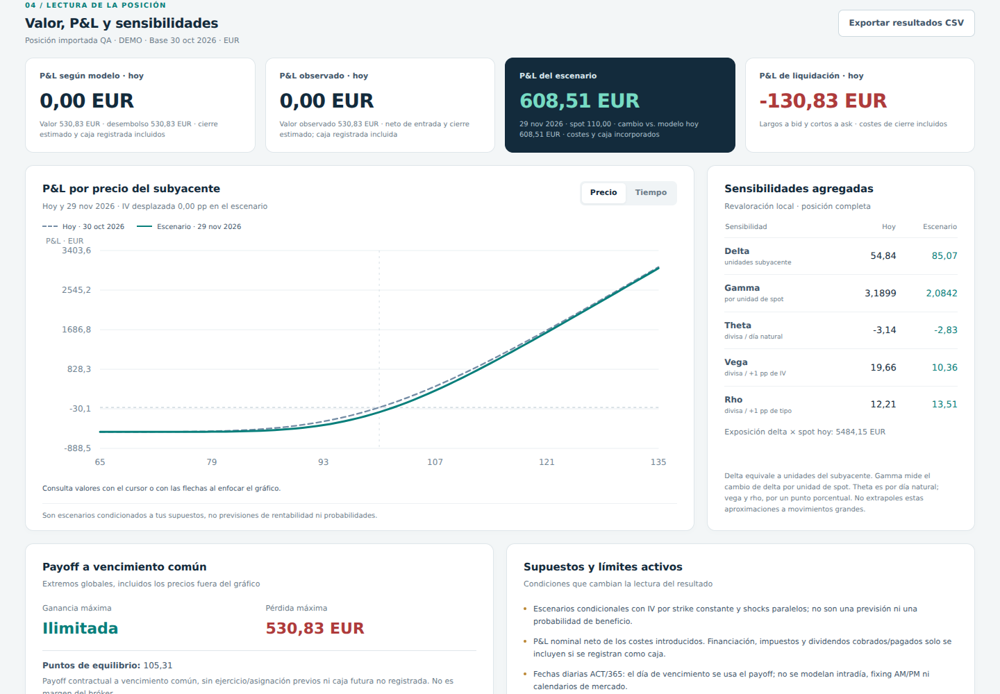

# OptionsLab · Calculadora de estrategias de opciones

Calculadora local de posiciones vanilla sobre **un subyacente y una divisa**, con patas sueltas o estructuras editables. Permite ver cuánto valdría una posición **antes de vencimiento**, cómo cambia con el spot, el tiempo, la volatilidad y los tipos, y qué exposición conserva cada pata.

El coste histórico, la marca de mercado y el precio del modelo se mantienen separados. No descarga cotizaciones ni envía órdenes: los datos de posición y mercado se introducen manualmente o mediante JSON. Los ejemplos contienen primas hipotéticas calculadas por el modelo, no precios negociables.



## Arranque

Necesitas Python 3.10 o superior. Desde una terminal:

```bash
git clone https://github.com/EugeniSegarra/calculadoraOpciones.git
cd calculadoraOpciones
python -m pip install -r requirements.txt
python -m optionslab
```

Se abre la aplicación en `http://127.0.0.1:8765`. El servidor solo escucha en el equipo local y los datos no se envían a ningún proveedor. Para elegir puerto o evitar la apertura automática del navegador:

```bash
python -m optionslab serve --port 8766 --no-browser
```

También funciona el nombre original del script: `python "P and L Opciones.py"`. Ahora es un lanzador sin fórmulas duplicadas ni preguntas interactivas al importar. Si prefieres instalar el paquete y su comando, ejecuta `python -m pip install .` y después `optionslab`.

## Qué se puede hacer

El editor admite acciones, calls y puts europeas o americanas, hasta 32 patas, cantidades con signo, multiplicador configurable, precio histórico de entrada, IV por pata, vencimiento, marca actual, bid/ask y costes totales de entrada y salida. Una cantidad positiva compra y una negativa vende: no existe un segundo selector de dirección capaz de invertir el signo otra vez. Las acciones se introducen en títulos, con multiplicador 1.

Las veinte plantillas incluyen calls y puts compradas/vendidas, spreads de calls y puts, straddles y strangles, butterfly, iron condor, covered call, protective put, collar, calendars y diagonal. Las plantillas son únicamente combinaciones de patas y se pueden modificar. Sus strikes y vencimientos son ilustrativos; el usuario debe sustituirlos por los términos del contrato que negocia.

La pantalla distingue el P&L a precios del modelo, el P&L a marcas introducidas y una estimación de cierre vendiendo las patas largas al bid y recomprando las cortas al ask. Si falta alguna marca, el agregado de mercado queda sin calcular; no se rellena con un precio teórico. Lo mismo ocurre con el cierre si faltan las cotizaciones del lado necesario. Si una fecha de cotización difiere de la fecha base, se conserva en el editor pero se excluye de los agregados actuales. Sin fecha explícita, el usuario declara que la cotización pertenece al snapshot de la fecha base.

El escenario revalora todas las patas con la fecha, spot y shocks elegidos. El gráfico por precio compara la curva actual con la del escenario; el gráfico temporal revalora a **spot fijo de escenario**, incluyendo la fecha elegida y las fechas relevantes de dividendos. Las curvas no simulan una trayectoria de precios. Las griegas aparecen agregadas y por pata, con unidades explícitas. Las posiciones se guardan y recuperan en JSON y los resultados se exportan a CSV.

## Interpretación financiera

El P&L por precios y caja registrada es el valor firmado actual de las posiciones menos el **desembolso inicial neto** —que ya incluye los costes de entrada—, menos los costes de cierre introducidos, más la caja registrada. El desembolso inicial neto es positivo si se paga y negativo si se recibe prima. Los costes son importes totales por pata: no se vuelven a multiplicar por contratos ni por multiplicador.

La caja de cartera recoge cobros y pagos ya realizados desde la entrada que no estén incluidos en precios y comisiones. La caja adicional de escenario representa flujos futuros que se incorporan solo en ese escenario. El gráfico temporal la excluye porque un importe único no especifica cuándo ocurre cada flujo. El tipo utilizado en la valoración es un tipo de descuento continuamente compuesto; no se interpreta como el tipo de financiación del bróker. No hay financiación, fiscalidad ni dividendos cobrados/pagados automáticos.

**Si hay acciones, su P&L por precios no incluye automáticamente los dividendos.** El calendario de dividendos o el yield sirven para valorar las opciones. Los dividendos de las acciones deben registrarse como caja: históricos en la cartera y futuros en el escenario. Por ejemplo, 100 acciones compradas a 100 que pasan a cotizar a 98 tras un dividendo de 2 muestran −200 por precios y 0 al añadir +200 de caja. Esta distinción también afecta a los límites de payoff, que excluyen caja futura no registrada.

Las cantidades mostradas como beneficio/pérdida máximos se obtienen del payoff lineal por tramos, evaluando cero, todos los strikes y la pendiente de la cola infinita; no son el máximo y mínimo de la ventana del gráfico. Una call vendida sin cobertura tiene pérdida ilimitada. Para varios vencimientos esos límites se dejan sin calcular: un calendar no tiene un único payoff terminal determinado únicamente por el spot final. Estas métricas son condicionales a los contratos abiertos y a la caja registrada; no son margen, riesgo máximo de liquidez ni una garantía frente a asignaciones.

### Tiempo, dividendos y ejercicio

Se utiliza ACT/365 Fixed con fechas diarias. El día de vencimiento el valor es el payoff y el spot introducido se interpreta como precio de liquidación del escenario. No se modelan horas, fixing AM/PM, festivos ni un 0DTE intradía. La fecha base se interpreta después del evento ex-dividendo de ese día; por eso el calendario solo admite ex-fechas futuras.

Las europeas sin pagos discretos usan Black–Scholes–Merton con yield continuo. Las americanas y los pagos discretos usan diferencias finitas con tratamiento del ejercicio y de los saltos de dividendo. Se elige **yield continuo o calendario de efectivo**, nunca ambos. El modelo discreto usa responsabilidad limitada: en cada ex-fecha el spot posterior es `max(S − D, 0)` y el dividendo efectivo no puede superar el valor de la acción. Si coincide con vencimiento, el dividendo ocurre antes del payoff; en americanas se permite ejercicio antes de ese salto.

**El horizonte se limita al primer vencimiento.** En un calendar, al vencer la pata corta se utiliza su payoff mientras la pata larga conserva tiempo y valor temporal. Pasado ese punto hay que registrar qué venció, se ejerció, se asignó o se cerró, y actualizar acciones/caja. Un precio futuro aislado no permite reconstruir esos hechos. Las americanas se valoran con ejercicio óptimo bajo el modelo, pero el escenario presupone que las patas siguen abiertas: no es un simulador de asignaciones reales.

### Griegas y volatilidad implícita

| Sensibilidad | Unidad de la posición completa |
|---|---|
| Delta | Unidades equivalentes del subyacente; cambio monetario por +1 unidad de spot |
| Gamma | Cambio de delta por +1 unidad de spot |
| Theta | Cambio local por día natural, manteniendo el spot constante |
| Vega | Cambio monetario por +1 punto porcentual de IV: 20% → 21% |
| Rho | Cambio monetario por +1 punto porcentual del tipo: 3% → 4% |

La exposición delta en dinero es delta × spot. Theta es una derivada local; no promete cuánto se ganará o perderá mañana. En vencimiento, en quiebros de payoff o cuando el límite no permite una sensibilidad única, se muestra «no disponible». En motores numéricos las griegas se aproximan por revaloración, con theta obtenida de la ecuación de valoración; cerca de ejercicio o eventos requieren más cuidado que un precio aislado.

La IV se infiere de una marca actual —o del midpoint de bid/ask actuales— con un método acotado. Nunca se utiliza la prima histórica de entrada como si fuese la cotización actual. Las cotizaciones incompatibles con el dominio o las cotas del modelo se rechazan. En zonas de ejercicio americano, una prima igual al intrínseco puede corresponder a múltiples IV y no se asigna arbitrariamente IV cero. La inversión de puts con dividendos discretos no se ofrece porque la convención liquidator puede generar falta de monotonía y raíces no únicas; su valoración con IV especificada sí está disponible.

Los escenarios mantienen la IV de cada strike al mover el spot (*sticky strike*) y permiten shocks paralelos. Una lista de IV manuales no constituye una superficie calibrada libre de arbitraje, y el resultado no es una previsión. No se presenta delta como probabilidad de acierto ni se mezclan probabilidades neutrales al riesgo con probabilidades reales.

## Uso reproducible en Python y terminal

```python
from optionslab.pricing import price_option, option_greeks

price = price_option(spot=100, strike=100, time=1,
                     rate=0.05, volatility=0.20, option_type="call")
print(price)  # 10.450583572185565 aproximadamente, por unidad
print(option_greeks(100, 100, 1, 0.05, 0.20))
```

```bash
python -m optionslab demo --output portfolio.local.json
python -m optionslab analyze portfolio.local.json --spot 110 --vol-shift 0.05 --output resultados.json
python -m unittest discover -s tests -v
```

En la API y en JSON, IV y tipos están en decimal; `.05` significa cinco puntos porcentuales. La interfaz convierte los porcentajes de IV y los puntos básicos de tipos. `--date YYYY-MM-DD` selecciona la fecha del escenario sin modificar el coste histórico. Los ejemplos de `examples/` contienen snapshots fijos reproducibles; `demo` genera fechas actuales.

El esquema está documentado en [docs/SCHEMA.md](docs/SCHEMA.md). No se importan silenciosamente campos incompatibles: otra divisa por pata, otro subyacente, barreras o entregables corporativos complejos se rechazan para evitar reinterpretar una posición.

## Validación y alcance

La suite utiliza identidades de no arbitraje, casos analíticos publicados, un árbol CRR independiente, límites de vencimiento/IV cero, comparaciones entre mallas, tests de contabilidad y pruebas de API. La auditoría adversarial y los resultados reproducibles están en [docs/VALIDATION.md](docs/VALIDATION.md). Para activar los contrastes independientes con QuantLib:

```bash
python -m pip install -r requirements-validation.txt
python -m unittest discover -s tests -v
```

El alcance numérico y los supuestos están en [docs/METHODOLOGY.md](docs/METHODOLOGY.md). Las fuentes académicas y profesionales, incluida la literatura reciente que informa las decisiones de diseño, están en [docs/RESEARCH.md](docs/RESEARCH.md). Un conjunto finito de pruebas no demuestra ausencia universal de errores; los límites del modelo se explicitan y las entradas no soportadas fallan de forma visible.

No incluye motores sobre futuros, opciones exóticas, calibración de superficies, volatilidad estocástica, saltos de precio de mercado, varios subyacentes o FX, ajustes de entregables corporativos, backtesting, cálculo de margen ni contabilidad automática de ejercicio/asignación. El motor resulta útil para valorar y someter a escenarios posiciones vanilla dentro de su dominio, con snapshots y términos contractuales revisados por quien lo utiliza.
